# Kel4-TugasNodeRED-ESP32

**Tugas MQTT-Node-RED pada ESP32**, Mata Kuliah Jaringan Sensor dan IoT, Kelompok 4

Sistem ini memonitoring suhu dan kelembapan di empat ruangan serta mengendalikan dua lampu di setiap ruangan. Setiap ruangan memakai satu ESP32 yang mengirim data dan menerima perintah lampu lewat broker MQTT publik HiveMQ. Node-RED berperan sebagai client yang menampilkan chart suhu, gauge kelembapan, status online/offline, dan 8 saklar lampu pada dashboard web.

## Link Video

Video presentasi dan video demo alat tersedia di folder Google Drive berikut:

**[📁 Video Tugas MQTT-Node-RED Kelompok 4 (Google Drive)](https://drive.google.com/drive/folders/1kfBlGkt-lNNUIyavZs1w3c7maFUQYm1P)**

## 1. Anggota Kelompok dan Ruangan

| No | Nama | NRP | Ruangan | Perangkat |
|:-:|---|---|---|---|
| 1 | Falihan Afzal Rozan | 2124600065 | Ruang 1, Dashboard Node-RED | Laptop, ESP32 |
| 2 | Rafi Dwi Yudiansyah P. | 2124600090 | Ruang 2 | ESP32 |
| 3 | M. Raka Gemilang | 2124600066 | Ruang 3 | ESP32 |
| 4 | Kalyana Daeva Ali | 2124600074 | Ruang 4 | ESP32 |

## 2. Arsitektur Sistem

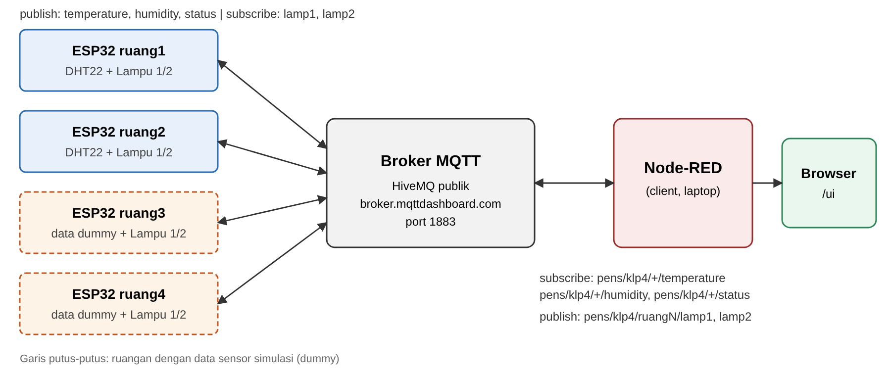

```
ESP32 ruang1 ─┐
ESP32 ruang2 ─┤                    ┌─────────────────────┐
ESP32 ruang3 ─┼──── MQTT 1883 ─────┤  Broker MQTT        ├──── Node-RED ──── Browser /ui
ESP32 ruang4 ─┘                    │  (HiveMQ publik)    │     (client)
                                   └─────────────────────┘
publish  : temperature, humidity, status       subscribe: pens/klp4/+/temperature
subscribe: lamp1, lamp2                                   pens/klp4/+/humidity
                                                          pens/klp4/+/status
                                               publish  : pens/klp4/ruangN/lamp1, lamp2
```

Setiap ESP32 mem-publish suhu, kelembapan, dan status ke topic ruangannya sendiri, serta men-subscribe topic lampu 1 dan lampu 2 ruangannya. Node-RED men-subscribe data keempat ruangan dengan wildcard `+`, lalu mem-publish perintah lampu ke topic ruangan yang dipilih. Status `offline` dikirim otomatis oleh broker melalui Last Will (LWT) bila ESP32 terputus.

## 3. Perangkat Keras

**Komponen per ruangan**

- 1 × ESP32 DevKit (ESP-WROOM-32D)
- 1 × sensor DHT22 (ruang 1 dan 2); ruang 3 dan 4 memakai data dummy
- 2 × LED + 2 × resistor 220 Ω (lampu 1 dan lampu 2)
- Kabel jumper dan breadboard

**Tabel pin**

| Komponen | Pin ESP32 | Catatan |
|---|---|---|
| DHT22 – DATA | GPIO16 | Pin tengah modul DHT22 (ruang 1 dan 2) |
| DHT22 – VCC | 5V | Pin samping modul |
| DHT22 – GND | GND | Pin samping lainnya |
| LED lampu 1 | GPIO22 | Anoda ke pin, katoda ke GND lewat resistor 220 Ω (semua ruangan) |
| LED lampu 2 | GPIO23 | Sama seperti lampu 1 (semua ruangan) |

Pin LED berbeda dari saran tugas (GPIO25/26) dan diganti ke GPIO22/23 untuk semua ruangan.

**Foto rangkaian satu ruangan**

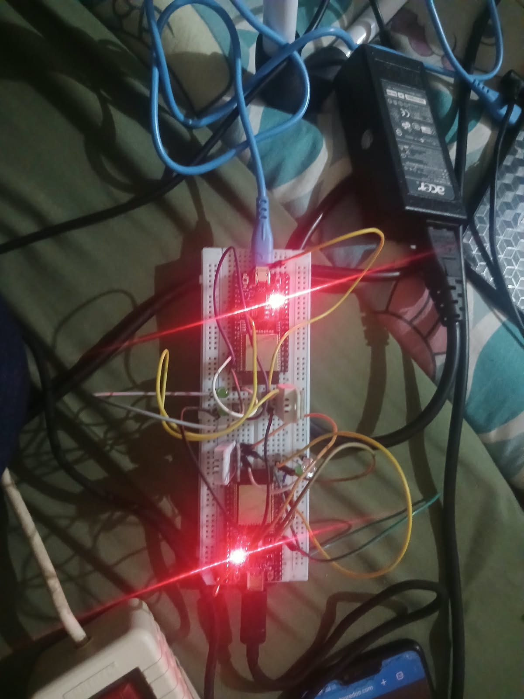

## 4. Tabel Topic Final dan Broker

Broker: **HiveMQ publik** `broker.mqttdashboard.com`, port `1883`, tanpa username/password.
Semua topic diawali prefix kelompok `pens/klp4/`, dengan `ruangN` = `ruang1` … `ruang4`.

| Topic | Arah | Payload | QoS | Retain |
|---|---|---|:-:|:-:|
| `pens/klp4/ruangN/temperature` | ESP32 → Node-RED | °C, 1 desimal, mis. `28.5` | 0 | Tidak |
| `pens/klp4/ruangN/humidity` | ESP32 → Node-RED | %, 1 desimal, mis. `65.0` | 0 | Tidak |
| `pens/klp4/ruangN/lamp1` | Node-RED → ESP32 | `1` = nyala, `0` = mati | 1 | Tidak |
| `pens/klp4/ruangN/lamp2` | Node-RED → ESP32 | `1` = nyala, `0` = mati | 1 | Tidak |
| `pens/klp4/ruangN/status` | ESP32 / LWT | `online` atau `offline` | 0 | Ya |

Wildcard di node `mqtt in` Node-RED: `pens/klp4/+/temperature`, `pens/klp4/+/humidity`, dan `pens/klp4/+/status`.
Client ID ESP32 dibentuk otomatis: `esp32-klp4-ruangN`.

## 5. Cara Menjalankan

### a. ESP32 (Arduino IDE)

1. Pasang board package **esp32** (Espressif Systems) lewat Boards Manager.
2. Pasang library lewat Manage Libraries:
   - **EspMQTTClient** (Patrick Lapointe)
   - **PubSubClient** (Nick O'Leary)
   - **DHT sensor library** (Adafruit)
   - **Adafruit Unified Sensor**

   Jika memakai board package ESP32 versi 3.x, lihat [Kendala no. 1](#9-kendala-dan-solusi).
3. Buka `esp32/esp32_ruang/esp32_ruang.ino`, lalu ganti bagian berikut sesuai board:
   ```cpp
   #define ROOM          "ruang1"         // ruang1 .. ruang4
   #define SENSOR_DUMMY  false            // true untuk ruang 3 dan 4
   #define WIFI_SSID     "SSID_LAB"       // nama Wi-Fi 2.4 GHz
   #define WIFI_PASS     "PASSWORD_LAB"   // password Wi-Fi yang digunakan
   ```
4. Pilih board **ESP32 Dev Module**, pilih port COM, lalu Upload.
5. Buka Serial Monitor (115200 baud) dan pastikan muncul `MQTT Connection established.`

### b. Node-RED

1. Pasang Node.js, lalu pasang dan jalankan Node-RED:
   ```bash
   npm install -g node-red
   node-red
   ```
2. Buka `http://localhost:1880`, lalu **menu ≡ → Manage palette → Install → `node-red-dashboard`**.
3. **Menu ≡ → Import →** pilih `node-red/flows.json` **→ Import**, lalu klik **Deploy**.

### c. Alamat dashboard

- Dari laptop: `http://localhost:1880/ui`
- Dari HP di jaringan yang sama: `http://<IP_laptop>:1880/ui`

## 6. Screenshot Flow Node-RED dan Dashboard

**Flow Node-RED (tab Tugas Gedung klp4)**

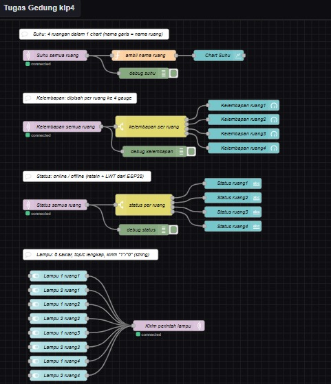

**Dashboard Node-RED (tab Gedung)**

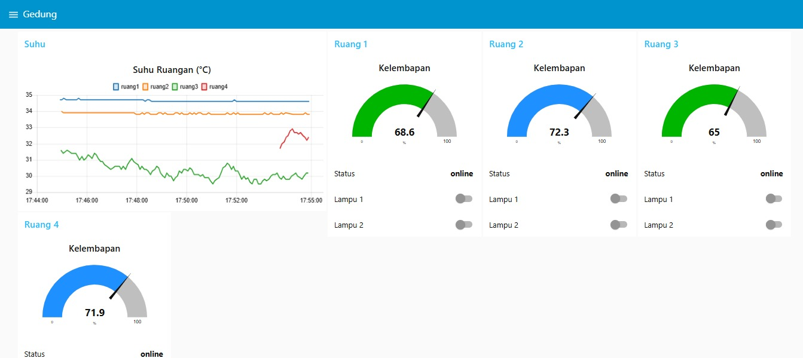

## 7. Hasil Pengujian T1–T12

| No | Uji | Hasil yang diharapkan | Hasil | Keterangan |
|:-:|---|---|:-:|---|
| T1 | Koneksi | Serial Monitor menampilkan `MQTT Connection established.` | ✓ | [Gambar](#t1-koneksi) |
| T2 | Data 4 ruang | Suhu dan kelembapan 4 ruang muncul tiap ±5 s; tab Debug ikut terisi | ✓ | Hanya ruang 1 dan 2 yang menggunakan sensor DHT. [Gambar](#t2-data-4-ruang) |
| T3 | Chart suhu | Chart menampilkan 4 garis `ruang1`–`ruang4` | ✓ | [Gambar](#t3-chart-suhu) |
| T4 | Sensor berubah | Hanya nilai ruangan yang sensornya ditiup/digenggam yang berubah | ✓ | [Gambar](#t4-sensor-berubah) |
| T5 | Lampu tepat sasaran | Saklar Lampu 1 ruang2 hanya menyalakan lampu 1 ruang2 | ✓ | [Gambar](#t5-lampu-tepat-sasaran) |
| T6 | Matikan lampu | Lampu 1 ruang2 mati | ✓ | [Gambar](#t6-matikan-lampu) |
| T7 | Payload salah | Kirim `ON` ke `lamp1`: tidak ada perubahan, ESP32 tidak error | ✓ | Tidak ada lampu yang menyala. [Gambar](#t7-payload-salah) |
| T8 | Status online | Keempat ruang berstatus `online` | ✓ | [Gambar](#t8-status-online) |
| T9 | LWT | Daya ESP32 ruang2 dicabut: status menjadi `offline` dalam ±15–25 s | ✓ | Setelah daya ruang2 dicabut, dashboard ruang2 menjadi offline. [Gambar](#t9-lwt) |
| T10 | Retained | Setelah restart Node-RED, status langsung tampil | ✓ | Setelah restart Node-RED, status langsung tampil tanpa menunggu. [Gambar](#t10-retained) |
| T11 | Reconnect | Wi-Fi dimatikan 10 s: ESP32 tersambung lagi, status `online`, data mengalir | ✓ | [Gambar](#t11-reconnect) |
| T12 | Akses dari HP | Dashboard tampil di HP dan saklar lampu berfungsi | ✓ | [Gambar](#t12-akses-dari-hp) |

### Dokumentasi pengujian

#### T1 Koneksi
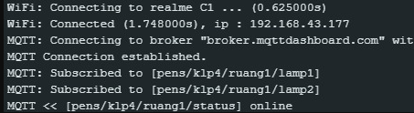

#### T2 Data 4 ruang
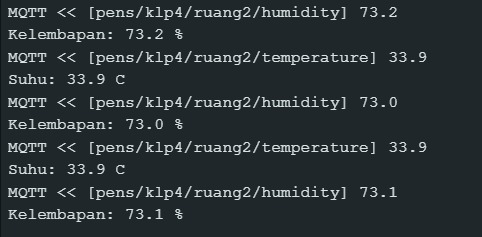

#### T3 Chart suhu
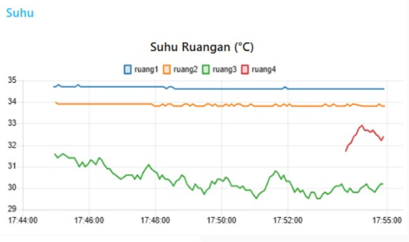

#### T4 Sensor berubah
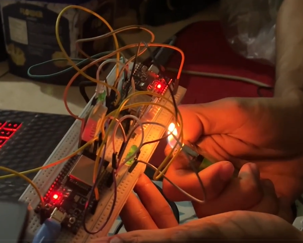 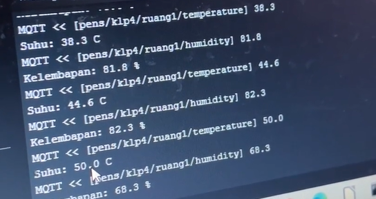 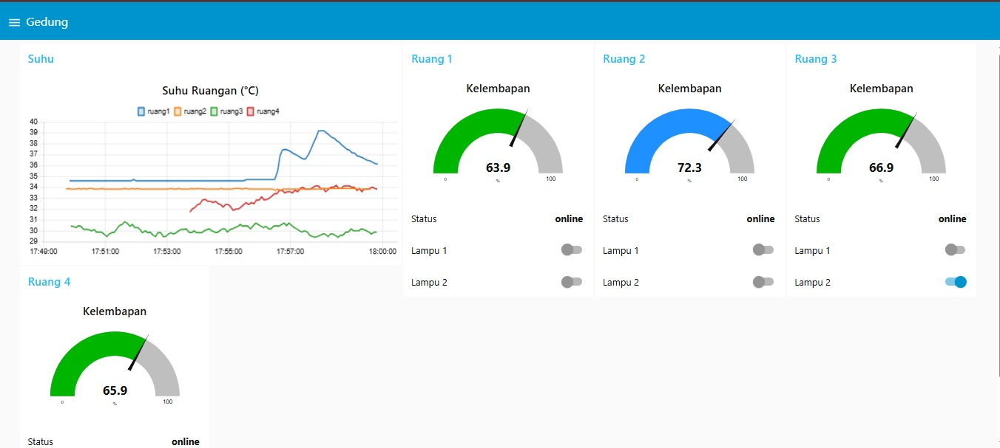

#### T5 Lampu tepat sasaran
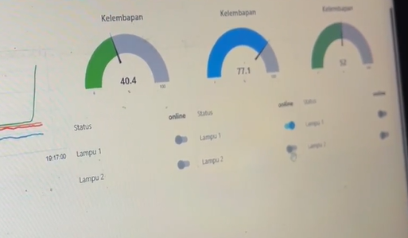 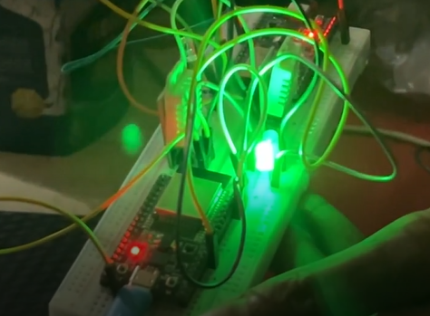

#### T6 Matikan lampu
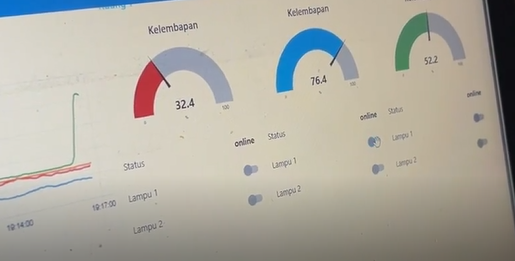 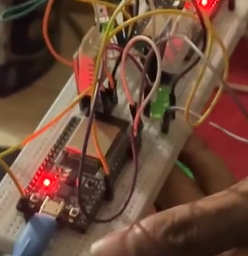

#### T7 Payload salah


#### T8 Status online


#### T9 LWT
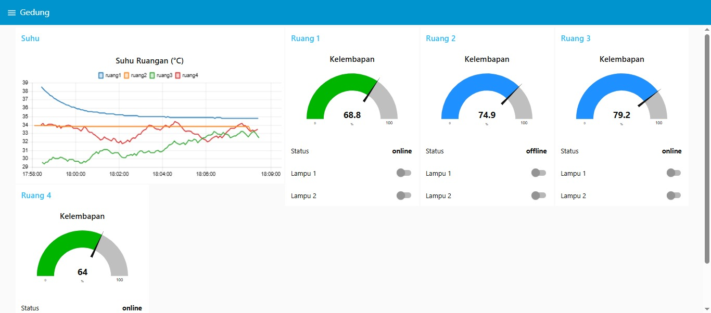 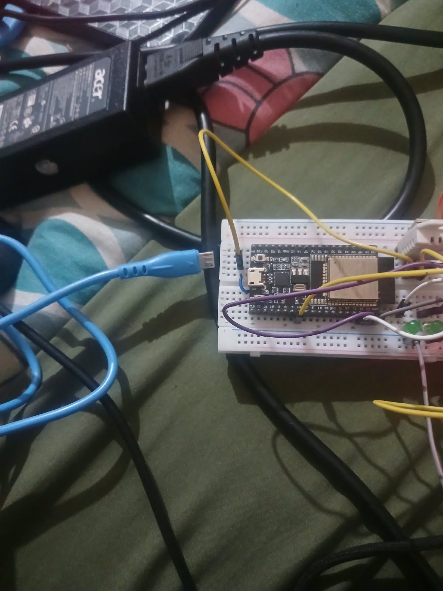

#### T10 Retained
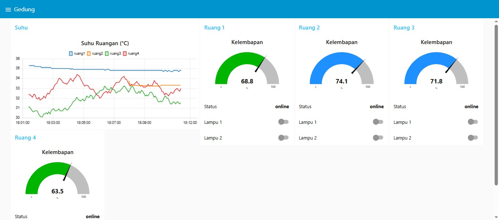

#### T11 Reconnect
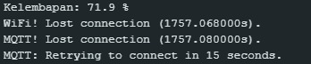

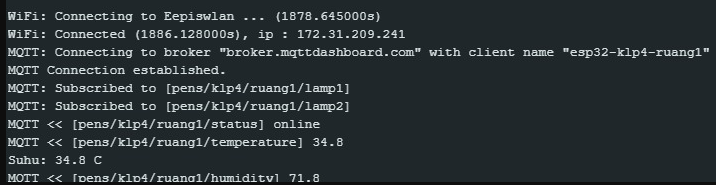

#### T12 Akses dari HP
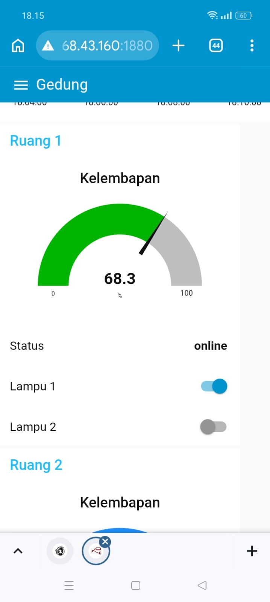 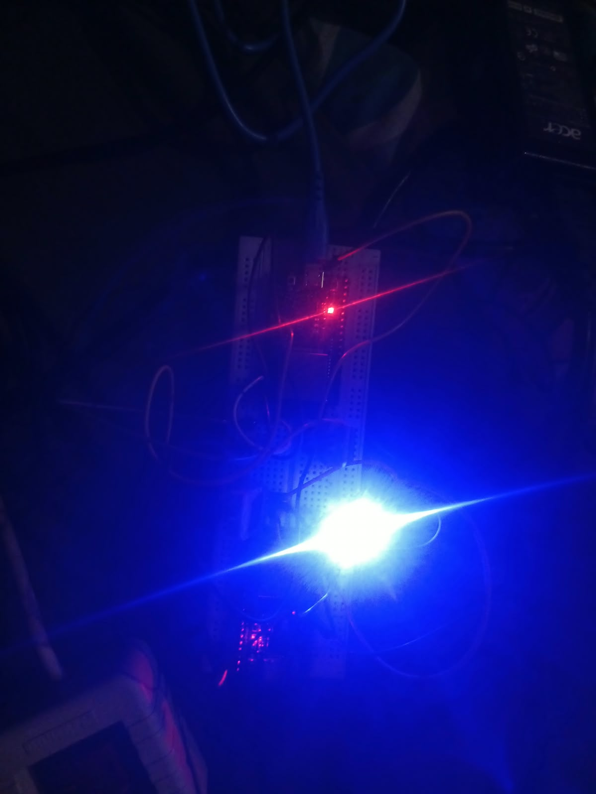

## 8. Ruangan yang Disimulasikan

Karena keterbatasan sensor DHT, hanya **ruang 1 dan ruang 2** yang memakai sensor DHT22 sungguhan. **Ruang 3 dan ruang 4** tetap memakai ESP32 sungguhan (lampu, status, dan LWT berfungsi normal), tetapi nilai suhu dan kelembapannya adalah data dummy yang dibuat di ESP32 dengan `SENSOR_DUMMY true`. Nilai dummy berubah perlahan setiap 5 detik dalam rentang 24–36 °C dan 40–90 %, dengan nilai awal berbeda per ruangan agar garis di chart tidak menumpuk. Uji T4 dilakukan pada ruangan dengan sensor sungguhan.

## 9. Kendala dan Solusi

| No | Kendala | Solusi |
|:-:|---|---|
| 1 | Proses compile ESP32 gagal dengan error `'WiFi' was not declared in this scope` di dalam library EspMQTTClient. | Library EspMQTTClient belum mendukung board package ESP32 versi 3.x (`WiFiClient.h` tidak lagi memuat `WiFi.h`). Ditambahkan baris `#include <WiFi.h>` di file `EspMQTTClient.h` (alternatif: memakai board package ESP32 versi 2.0.17). |
| 2 | ESP32 tidak bisa tersambung ke Wi-Fi kos; Serial Monitor terus menampilkan `WiFi! Connection attempt failed`. | Jaringan yang dipakai adalah Wi-Fi 5 GHz (nama berakhiran `_5G`), sedangkan ESP32 hanya mendukung 2.4 GHz. Koneksi diganti ke hotspot HP dengan pita 2.4 GHz. |
| 3 | Nilai sensor ruang 1 tidak wajar (suhu sekitar 1.7 °C dan kelembapan sekitar 17 %). | Sensor yang terpasang adalah DHT22 (putih), tetapi kode diset DHT11 sehingga data dibaca dengan format yang salah. `DHTTYPE` diganti menjadi `DHT22` dan nilai menjadi wajar (sekitar 34 °C dan 65 %). |
| 4 | Sensor ruang 2 gagal dibaca (`nan`) saat diset DHT22, tetapi menghasilkan nilai yang salah saat diset DHT11. | Sensor DHT22 (kemungkinan versi tiruan) tidak merespons sinyal start mode DHT22 yang pendek (±1,1 ms). Sinyal start mode DHT22 di library (`DHT.cpp`) diperpanjang menjadi 18 ms sehingga sensor merespons dan data dibaca dengan format DHT22. |
| 5 | Jumlah sensor DHT tidak mencukupi untuk empat ruangan. | Ruang 3 dan ruang 4 tetap memakai ESP32 sungguhan, tetapi suhu dan kelembapannya disimulasikan dengan `SENSOR_DUMMY true`. Lampu, status online/offline, dan LWT tetap berfungsi normal. |
| 6 | Halaman `http://localhost:1880/ui` menampilkan `Cannot GET /ui`. | Paket `node-red-dashboard` belum terpasang dan belum ada node dashboard yang di-Deploy. Paket dipasang lewat Manage palette, lalu node dashboard di-Deploy. |

## 10. Pembagian Tugas Anggota

| Nama | Ruangan | Tugas |
|---|---|---|
| Falihan Afzal Rozan | Ruang 1, Dashboard | Membuat flow Node-RED |
| Rafi Dwi Yudiansyah P. | Ruang 2 | Membuat program `.ino` |
| M. Raka Gemilang | Ruang 3 | Merangkai ESP dan sensor |
| Kalyana Daeva Ali | Ruang 4 | Membantu membuat flow Node-RED |

